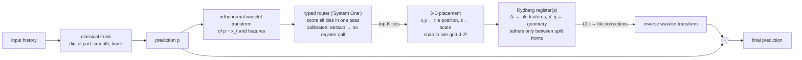

# Per-input register configuration: positions in x, y, z, connectivity, tethering, and routing the hard analog part

Sep 22 2026. Deep-research request: parameterized and non-parameterized, on-the-go ways to assign atom positions
(x, y, z) and their connections; optimal configurations as graphs; tethering; whether a "System One" decision
model such as Jev can drive the assignment; and a signal-processing (FFT / wavelet) proof of which part should go
to the register and which to the classical trunk, with Lean for the math.

Produced in this session:
- `formal/QuotaScaling/SpectralRouting.lean`: 18 theorems, standard axioms only, no `sorry`.
- `paper/spectral/`:
  - `band_analysis.py`, `router_capture.py`, `learned_router.py`, `tile_graph.py`
  - results in `runs/spectral/trl2d_*.json`

## 0. The answer in five lines

1. **Our current insertion point cannot reach the hard part.** The bottleneck mean-pools the latent, so the
   register sees only its DC spatial mode (Lean: `pool_blind`, `pool_blind_mode`), which holds 19% of the latent
   energy. Its only measurable effect on TRL2D is at k = 0 (−0.49% ± 0.21, 3/3 seeds), and that band holds just
   **2.9%** of the error energy.
2. **The hard analog part is sparse, high-wavenumber and localised.** The trunk misses 8–11% of the one-step change
   at |k| ≤ 8 but about 45% at |k| ≥ 33, and the top 1% of wavelet tiles hold 92% of the detail error energy.
3. **30 atoms placed on the right tiles have an 11× higher ceiling.** The top-30 tiles hold **32.9%** of the detail
   error energy (≈ 27% of the total), against the 2.9% ceiling of the DC insertion (Lean:
   `residual_after_band_removal`).
4. **"On the go" is feasible.** A zero-parameter router using the trunk's own predicted change captures 9.4%, about
   1,650× random (5.7×10⁻⁵). **With scarce qubits the non-parameterized router wins**: learned routers (§4.4) lose
   to it at K ≤ 300 on both VALID and TEST, and win only from K ≈ 1000. The chosen tiles form small clusters that
   chain across scales, which maps naturally to a **3-D register: x, y from tile position, z from scale**.
5. **Jev fits as a design pattern, not as a component.** Typed options with calibrated probabilities in one
   parallel pass is exactly the router we need. The product itself is text-only, API-only, 70–500 ms per call and
   non-differentiable, so we build the pattern in-graph and keep Jev out of the model path.

## 1. What "configuration" means physically, and how fast each lever moves

| Lever | Physics | What it sets | Change time | Per-input? |
|---|---|---|---|---|
| Local detuning Δᵢ | light shift from addressing beams | on-site field, the data encoding | µs | yes (we already do this) |
| **Occupancy of a fixed site grid** | every shot already rearranges a stochastically loaded array into a target pattern (AOD pick-up/drop-off ~100s µs, transport ~0.5 m/s, 3 ms per move) | which positions exist, hence the interaction graph | ~ms, inside the normal shot cycle | **yes, at essentially no extra cost** |
| Continuous positions rᵢ | SLM holograms (kHz refresh; phase-stable updates 2604.04600) or 3-D AOD lens (4.2 m/s over 200×200×136 µm, *Optica Quantum* 2026) | V_ij = C₆/r⁶ (isotropic), or C₃(1−3cos²θ)/r³ (dipolar, anisotropic) | ms, plus hologram computation | per task or per cluster; per input only with a fast 3-D AOD |
| z (third dimension) | 3-D tweezer arrays (Barredo 2018, 72 atoms; plane-selective control 2501.05935) | non-planar graphs (K₅, K₃,₃; Kuratowski), 12 neighbours instead of 6, **signed or zero dipolar couplings** | as for positions | as for positions |
| Tethers | auxiliary-atom quantum wires (Kim et al., *Nat. Phys.* 2022, 3-D); messenger qubits for all-to-all (2504.05087); far-detuned relay atoms reshaping the interaction range (2508.02815); coherent transport of entangled atoms (Bluvstein et al.) | long-range edges between distant atoms, at an atom cost of about distance / blockade radius | ms (transport) or static (wires) | per cluster |

Two consequences drive the design:
- The cheap per-input lever is a **discrete choice of which sites of a pre-computed 3-D grid to occupy**, not a free
  continuous position. That turns positioning into a typed selection problem.
- **Minimum atom spacing holds by construction on a lattice grid.** Distinct sites of d·ℤ³ are at least d apart
  (Lean: `lattice_sep`).

## 2. State of the art (Sep 2026)

| | Non-parameterized (rule / embedding) | Parameterized (learned) |
|---|---|---|
| **Per task** | Unit-disk and 3-D embeddings of graphs: 3-D reduction with O(min{m√n, n²}) atoms (PRA 2025); gadget limitations (2508.06130); QUBO → distances for feature selection (Kipu). Reservoir-geometry studies (2411.13401): lattice type matters little, performance plateaus with spacing, **breaking spatial symmetry matters**. | PulserDiff (Pasqal, 2505.16744): **trainable register coordinates** in PyTorch. Trainable-frequency models (Jaderberg et al., *PRA* 2024). RL hardware co-design (2504.11737). Our trained geometry. |
| **Per input** | Quantum evolution kernel (Henry et al., *PRA* 2021): graph → positions. **Attributed-graph kernels (2509.09421): edge features → positions, node features → local detunings.** Both assume the input *is* a graph. | **HyperQ (2609.24657, 21 Sep 2026)**: per-token rotation angles, **coupling strengths** and measurement axes for 16–64-qubit abstract circuits, +4.71 over the backbone and +3.67 over LoRA (parameter matching unclear). TensorHyper-VQC (*npj QI* 2025): hypernetwork-generated gate parameters. QMoE (2507.05190) and hybrid MoE (2512.22296): quantum routers or experts. Our Wave-G per-input budgets (null). |

Signal-processing theory we build on:
- **Quantum models are truncated Fourier series.** Their accessible frequencies are fixed by the eigenvalue
  differences of the encoding generator (Schuld, Sweke & Meyer, *PRA* 103, 032430, 2021). Making the generator
  trainable makes the frequencies trainable (Jaderberg et al. 2024).
- **PQCs fit low frequencies first**, through coefficient redundancy (Duffy & Jastrzebski, 2506.22555). QNN
  training follows spectral *amplitude* rather than frequency index (Spectral Amplitude Principle, Xu, Zhang &
  Yan, 2409.06682). This is the opposite of the classical spectral bias that makes neural operators over-smooth
  high wavenumbers (HFS, 2503.13695; guidelines, 2602.19265).
- **Wavelet coefficients of natural signals are sparse and depend parent-to-child across scales** (the
  wavelet-tree / hidden-Markov-tree model of Crouse, Nowak & Baraniuk, *IEEE TSP* 1998).

**Gap:** no published work routes the spectral or wavelet content that a classical trunk fails on to atoms whose
3-D placement is derived from that content. HyperQ is closest, but it is abstract (no geometry, no hardware
spacing constraints, no z) and is not tied to where the trunk fails.

## 3. Formal backbone (Lean 4.19 + Mathlib; `lake build` ✓; `#print axioms` = propext, Classical.choice, Quot.sound only)

| Theorem | Statement | Why it matters |
|---|---|---|
| `pool_blind`, `mode_zero_mean`, `pool_blind_mode`, `broadcast_orthogonal` | Mean-pooling is invariant to every zero-mean perturbation, in particular any non-DC discrete Fourier mode (ζⁿ = 1, ζ ≠ 1). A broadcast correction is orthogonal to every zero-mean field. | A pool → core → broadcast bottleneck reads and writes only the DC mode. This is a mechanistic explanation of the campaign's nulls. |
| `band_energy_split` | For **any** orthonormal basis (discrete Fourier or orthonormal wavelets) and any band assignment, Σ_bands band energy = ‖e‖². | Per-band difficulty measurements add up exactly, so routing decisions per band are well posed. |
| `coeff_after_removal`, `residual_after_band_removal` | Removing the error's components on a coefficient set T leaves exactly the energy outside T. | The **ceiling** for any corrector restricted to K bands or tiles. It justifies the oracle curves in §4. |
| `total_eq`, `pointwise_min_optimal`, `swap_improves`, `swap_card` | With separable costs, per-band argmin is optimal without a budget. Under a budget, swapping a band for one with at least as much gain keeps the budget and never increases the total. | Optimal budgeted assignment of bands to the register is **top-K by gain**. The router's job is to estimate the gain. |
| `reupload_degree` | L encoding layers of degree ≤ 2 in z (Laurent exponents in {−1, 0, 1}) give total degree ≤ 2L, i.e. the spectrum lies in [−L, L]. | Layer count sets the register's frequency reach. The circuit-to-polynomial step is the standard Schuld–Sweke–Meyer argument, not formalised. |
| `vdw_hasDerivAt`, `vdw_sensitivity_anti` | d/dr (C r⁻⁶) = −6 C r⁻⁷, and 6C/r⁷ strictly decreases with r. | **Input-dependent geometry is frequency modulation.** Nearer atoms react with a higher local frequency to the same change of input, so geometry can "zoom" onto sharp features. |
| `lattice_sep` | Distinct points of d·ℤ³ are at least d apart. | Per-input occupancy patterns on a site grid are hardware-valid by construction. |
| `dip_inplane`, `dip_axial`, `dip_magic` | The dipolar factor 1 − 3z²/r² is +1 for every in-plane pair, −2 for an axial pair, and 0 at the magic angle z² = (x² + y²)/2. | **In 2-D with the axis normal to the plane, every coupling has the same sign.** Signed couplings (frustration and interference between paths) and switched-off couplings need z. |

None of these theorems asserts that any model predicts better, and none is a quantum-advantage claim. They
state what the architecture *can* reach, and what the physics lets geometry do.

## 4. Evidence: FFT and wavelets on TRL2D (The Well), official CNextU-net trunk, 180 test windows, GPU

Both decompositions were checked to conserve energy before use: Haar relative error 0, FFT shells 2×10⁻⁷.

### 4.1 Where the trunk fails: the hard analog part

| |k| band | share of error energy | share of one-step change energy | fraction of the change the trunk misses |
|---|---|---|---|
| 0 (DC) | 0.029 | 0.022 | 0.23 |
| 1–4 | 0.201 | 0.361 | 0.08–0.11 |
| 5–16 | 0.428 | 0.459 | 0.11–0.21 |
| 17–32 | 0.231 | 0.116 | **0.34** |
| ≥ 33 | 0.111 | 0.042 | **0.44–0.45** |

The wavelets show the same picture. The trunk misses 11% of the change at the coarsest scale, rising to 18, 26,
32 and 37% at 16, 8, 4 and 2 pixels. The error energy peaks at 8–16 px scales (48%).

**Sparsity:** the top 1% of the 196,416 detail tiles per sample hold **91.8%** of the detail error energy.

This is the classic spectral bias of neural operators. The trunk handles the smooth, low-wavenumber digital part,
and what remains hard is localised, high-wavenumber, intermittent structure.

### 4.2 What the current register actually does

| band | vanilla → register, paired over 3 seeds | vanilla → matched MLP |
|---|---|---|
| k = 0 | **−0.49% ± 0.21** (3/3 lower) | +0.10% ± 0.19 |
| every other band | −0.04 … −0.18%, all within seed noise | +0.03 … +0.15%, within noise |

The register's only measurable effect is on the one band it can see (`pool_blind`). That band holds 2.9% of the
error energy, which is also why pooled improvements elsewhere in the campaign were bounded near zero.

### 4.3 Routing the hard tiles: ceiling vs zero-parameter routers (share of detail error energy captured by K tiles)

| K atoms | 1 | 10 | 30 | 100 | 300 | 1000 | 3000 |
|---|---|---|---|---|---|---|---|
| oracle (ceiling, `residual_after_band_removal`) | 0.044 | 0.191 | **0.329** | 0.520 | 0.701 | 0.857 | 0.946 |
| trunk's predicted change (0 params) | 0.003 | 0.040 | **0.094** | 0.195 | 0.345 | 0.553 | 0.738 |
| recent change x_t − x_{t−1} (0 params) | 0.005 | 0.031 | 0.069 | 0.151 | 0.283 | 0.472 | 0.657 |
| input detail energy (0 params) | 0.007 | 0.030 | 0.074 | 0.168 | 0.298 | 0.496 | 0.679 |
| random | 0.000 | 0.000 | 0.000 | 0.000 | 0.002 | 0.005 | 0.015 |

### 4.4 Parameterized router (learned tile scorer, trained on TRAIN, evaluated once on TEST)

Two learned scorers (51k parameters, 1,500 steps, TRAIN split). Selection is on VALID, and TEST is reported
for every candidate. The first MSE run, evaluated on TEST only, is kept in `trl2d_learned_router_mse_v0_testonly.json`
and agrees with these numbers.

| K atoms | 1 | 10 | 30 (VALID / TEST) | 100 | 300 | 1000 | 3000 |
|---|---|---|---|---|---|---|---|
| oracle | 0.044 | 0.191 | 0.321 / 0.329 | 0.520 | 0.701 | 0.857 | 0.946 |
| **zero-parameter: trunk's predicted change** | 0.003 | **0.040** | **0.093 / 0.094** | **0.195** | **0.345** | **0.553** | 0.738 |
| learned: regress log tile energy (MSE) | 0.001 | 0.010 | 0.026 / 0.031 | 0.092 | 0.238 | 0.538 | **0.814** |
| learned: listwise loss, residual on the zero-parameter prior (zero-init) | 0.002 | 0.018 | 0.043 / 0.047 | 0.115 | 0.260 | 0.543 | 0.813 |

(Test values except where marked.)

**Reading:**
- Both learned routers **lose to the zero-parameter router at every budget up to K = 1000** and win only at
  K = 3000 (+7.5 points).
- Even the residual router, initialised exactly at the prior, drifted away from it at small K. Distribution-level
  objectives (log-regression, listwise KL) are dominated by the bulk of the ~196k tiles, whereas a 30-atom budget
  depends only on the extreme tail.
- **Decision rule:** with scarce qubits (K ≲ 300), route non-parametrically by the trunk's own predicted change.
  Learned routing pays only with many atoms.
- A top-K-specific objective (NDCG@K / LambdaLoss, or a differentiable top-K capture loss) is the untested next
  step. It is future work, not a result.

### 4.5 Graph structure of the hard tiles (top-30 per sample)

| tiles | spatial edges / node | cross-scale (parent–child) edges / node | largest connected cluster |
|---|---|---|---|
| oracle | 0.65 | 0.47 | 21% of atoms |
| trunk's predicted change | 0.95 | 0.49 | 26% |
| random | 0.00 | 0.00 | 3% (all isolated) |

The hard tiles are not scattered points. They form **several small fronts, each chaining across scales**: about
half of them have their parent or child among the top 30. Couplings are therefore meaningful within a front,
and the scale axis is a physical axis of the problem. This motivates the 3-D mapping below and a partition into a
few small registers (our 3 × 10 already fits), with tethers reserved for fronts that split.

## 5. Proposed architecture: the Spectral-Routed Register (SRR)

1. **Digital part:** the trunk as today, unchanged and frozen or fine-tuned.
2. **Hardness map:** an orthonormal wavelet transform of inference-time quantities: the trunk's predicted
   change, the recent change, and the input.
3. **Typed router:** per-tile scores in one parallel pass, then top-K, where K is the atom budget.
   - **Default at K ≤ 300 (the VALID-selected winner):** the zero-parameter router, ranking tiles by the energy of
     the trunk's predicted change.
   - The learned scorers of §4.4 win only at K ≈ 1000 and above. A top-K-specific loss, or end-to-end Gumbel top-K /
     Sinkhorn training, is the next thing to try.
   - Probabilities are calibrated (temperature-scaled on VALID, ECE reported). If the top score is below a
     threshold the register is **not called**, so the quantum budget goes only where the router is confident.
4. **Geometry per input:** tile (level j, y, x) → atom at (x, y, z = j·Δz), snapped to the site grid.
   - Neighbouring tiles couple within a scale plane, and parent–child tiles couple across planes. The
     interaction graph physically realises the wavelet-tree dependency structure.
   - Δz/d is one knob for the cross-scale to in-plane coupling ratio, (d/Δz)⁶.
   - The dipolar variant adds signed couplings between planes (`dip_axial`).
   - The parameterized refinement adds bounded learned offsets |δr| < d/2, which never collide, from a
     hypernetwork. Positions per input then act as frequency modulation (`vdw_sensitivity_anti`).
5. **Register:** detunings from the tile's local features (as now). A few small registers, one per front.
6. **Write-back in the right basis:** ⟨Zᵢ⟩ → zero-init gated correction of tile i's coefficient → inverse
   transform → added to p. The register now writes where the error is, instead of into the DC mode.

## 6. Jev (TypeSafe AI) — fit assessment

**What it is (verified):**
- Launched 15 Sep 2026 by TypeSafe AI, built by Diogo Almeida (co-inventor of RLHF and InstructGPT at OpenAI;
  the pasted text says "Diego"). $40M round led by DCVC.
- It returns typed decisions (choice from a supplied set, rubric score, yes/no) with calibrated probabilities,
  in one parallel pass. Up to 255 options single-stage, with a two-stage mode beyond that.
- Input is text or structured program state; no images yet. API-only, with no weights or architecture published.
- 70–500 ms end to end. $0.042 per million input tokens, and output is free. Speed and "no hallucination" are
  launch claims, not yet independently tested.

**Fit for per-input register configuration:**

| Requirement | Jev | In-graph typed router (ours) |
|---|---|---|
| Decides from tensors (wavelet maps, latents) | serialise to text: lossy and slow | native |
| Per-sample latency inside training | 70–500 ms × ~10⁵–10⁶ samples per run, i.e. hours to days of routing latency | < 1 ms on GPU |
| Differentiable, so geometry and trunk co-train | no | yes (Gumbel top-K / Sinkhorn / straight-through) |
| Reproducible and double-blind safe | proprietary API, versions change | code in repo |
| Typed options + calibrated confidence + abstain | **yes, the design pattern we want** | yes (temperature scaling, abstain threshold) |

**Recommendation:** adopt the *System One pattern* in-graph: a finite typed option set (tile set, geometry
codebook entry, or "no register"), one-pass scoring, calibrated confidence, and abstention. Keep Jev out of the
model path of any reported number. A legitimate optional use is **campaign orchestration**, i.e. typed decisions
over run logs (which configuration family to try next, whether to retry or skip a crashed arm). There it only
schedules work and changes no result.

## 7. Experiment plan (pre-register before running; one row first, TRL2D)

- **Stage A (classical only, done except calibration).** Oracle, zero-parameter and learned capture curves (§4);
  the zero-parameter router is selected at K = 30. Remaining: a top-K-specific learned objective, router
  calibration (ECE) and the abstain curve.
- **Stage B (the test).** Same trunk, K = 30, 3 × 10 registers, 20k steps, 3+ seeds, length-matched. Arms:
  - (i) trunk;
  - (ii) SRR tiles + **matched-MLP corrector on the same tiles**, the classical control for "quantum on the hard part";
  - (iii) SRR register, 3-D pyramid geometry;
  - (iv) SRR register with **fixed 2-D grid geometry**, which isolates the per-input geometry claim;
  - (v) SRR register, **Gutzwiller mean-field**, which isolates entanglement;
  - (vi) SRR register on **random tiles**, which isolates routing.
  - Endpoints: VRMSE, and error energy in |k| ≥ 17. Decision rule as in `31-…`.
- **Stage C.** Dipolar (signed, z-dependent) vs van der Waals couplings; tethers between split fronts; the Δz/d
  sweep.
- **Stage D (hardware realism).** Occupancy patterns on d·ℤ³ (valid by `lattice_sep`), rearrangement moves per
  shot from `atommovr` (2508.02670), and shot budget per input.

The claim that would matter is (iii) > (ii) *and* (iii) > (iv) *and* (iii) > (v) on the high-k endpoint. Anything
less is reported as a classical-routing result. That result would still be useful, because an SRR-MLP gain alone
shows the value of spectral routing.

## 8. Limits

- The ceilings are *energy* ceilings for exact tile correction. Real correctors reach a fraction of them, and
  VRMSE weights fields differently.
- Routing uses inference-time proxies. A proxy's miss becomes a miss of the register.
- The decoder is nonlinear, so the register's DC input can in principle leak to other bands. §4.2 shows that in
  practice it does not.
- Classically simulating K = 30 atoms as 3 × 10 registers keeps each register's coupling graph within 10 atoms.
  Cross-register fronts need tethers, which cost atoms.
- Everything here is classically simulable at this size. No claim of quantum advantage is made or implied.

## Sources

Jev: [TypeSafe blog](https://typesafe.ai/blog/introducing-system-one-models-and-jev) ·
[TrueFoundry](https://www.truefoundry.com/blog/typesafe-ai-jev) · [DataCamp](https://www.datacamp.com/blog/system-one-models-jev).
Hardware: [3-D assembled arrays, Nature 2018](https://www.nature.com/articles/s41586-018-0450-2) ·
[3-D AOD lens, 2510.11451](https://arxiv.org/abs/2510.11451) · [plane-selective 3-D control, 2501.05935](https://arxiv.org/abs/2501.05935) ·
[continuous 3,000-qubit operation, Nature 2025](https://www.nature.com/articles/s41586-025-09596-6) ·
[phase-stable hologram updates, 2604.04600](https://arxiv.org/pdf/2604.04600) · [atommovr, 2508.02670](https://arxiv.org/pdf/2508.02670) ·
[zoned compilers: ZAC 2411.11784](https://arxiv.org/abs/2411.11784), [routing-aware placement 2505.22715](https://arxiv.org/abs/2505.22715), [2512.13790](https://arxiv.org/html/2512.13790v1).
Connectivity and tethering: [Rydberg quantum wires, Nat. Phys. 2022](https://www.nature.com/articles/s41567-022-01629-5) ·
[3-D MIS embedding, PRA 2025](https://journals.aps.org/pra/abstract/10.1103/516n-6wtx) · [messenger qubits, 2504.05087](https://arxiv.org/pdf/2504.05087) ·
[relay atoms, 2508.02815](https://arxiv.org/abs/2508.02815) · [gadget limitations, 2508.06130](https://arxiv.org/abs/2508.06130) ·
[dipolar angular dependence, 2501.08233](https://arxiv.org/pdf/2501.08233).
Geometry and learning: [QEK, 2107.03247](https://arxiv.org/abs/2107.03247) · [attributed-graph kernels, 2509.09421](https://arxiv.org/abs/2509.09421) ·
[Kipu feature selection](https://kipu-quantum.com/blog/analog-quantum-feature-selection-with-neutral-atoms) ·
[QRC on 108 qubits, 2407.02553](https://arxiv.org/abs/2407.02553) · [QRC in atomic lattices, 2411.13401](https://arxiv.org/html/2411.13401v1) ·
[PulserDiff, 2505.16744](https://arxiv.org/abs/2505.16744) · [RL hardware co-design, 2504.11737](https://arxiv.org/abs/2504.11737) ·
[HyperQ, 2609.24657](https://arxiv.org/abs/2609.24657) · [TensorHyper-VQC, npj QI 2025](https://www.nature.com/articles/s41534-025-01157-z) ·
[QMoE, 2507.05190](https://arxiv.org/abs/2507.05190) · [hybrid QC MoE, 2512.22296](https://arxiv.org/abs/2512.22296).
Spectral theory: [trainable frequencies, 2309.03279](https://arxiv.org/abs/2309.03279) · [spectral bias in VQML, 2506.22555](https://arxiv.org/abs/2506.22555) ·
[Spectral Amplitude Principle, 2409.06682](https://arxiv.org/abs/2409.06682) · [Fourier view of QNNs, Commun. Phys. 2026](https://www.nature.com/articles/s42005-026-02680-x) ·
[neural-operator HFS, 2503.13695](https://arxiv.org/abs/2503.13695) · [spectral-bias guidelines, 2602.19265](https://arxiv.org/abs/2602.19265).
Classic references (not re-fetched): Schuld, Sweke & Meyer, *PRA* 103, 032430 (2021); Crouse, Nowak & Baraniuk,
*IEEE TSP* 46(4) (1998).

## Addendum (Sep 23, before any Stage B run): SRR pilot

- **What:** `paper/spectral/srr.py`, wired as `srr-<core>[-rand]` into `paper/phase_b/cnext_hybrid.py`.
- **Checks passed before training (GPU):**
  - The inverse Haar is exact (max error 5e-7).
  - Every arm is identical to the trunk at initialisation (zero-init `alpha`).
  - Core parameters are matched: register 154, DeepSets MLP 157. The routed linear read-out (108 parameters) is shared by all arms.
  - Gradients reach every SRR parameter.
- **Pilot (non-decisive):**
  - Seed 1337, 5k steps, Phase B protocol otherwise (batch 16, lr 1e-4, AdamW, VALID only).
  - Arms, run one at a time (`runs/srr_pilot_runner.sh`): vanilla (length-matched), srr-lin, srr-mlp, srr-ryd.
- **Reason for the pilot:** the GPU is shared with the Sophelio NAS and the TDC and RealPDE runs, so the full Stage B (3 × 20k-step arms × 3 seeds) is ~1 day. The pilot decides whether it is worth that.
- **Decision rule, fixed now:** run the full Stage B (3 seeds, 20k steps, plus gutz / ryd2d / rand controls) only if **both** holds on VALID:
  - srr-ryd beats vanilla by more than 0.5%;
  - srr-ryd is not worse than srr-mlp.
- **Otherwise:** report the pilot as null and stop the SRR line on TRL2D. The routed-linear arm alone tells us whether routing itself helps the classical corrector.
