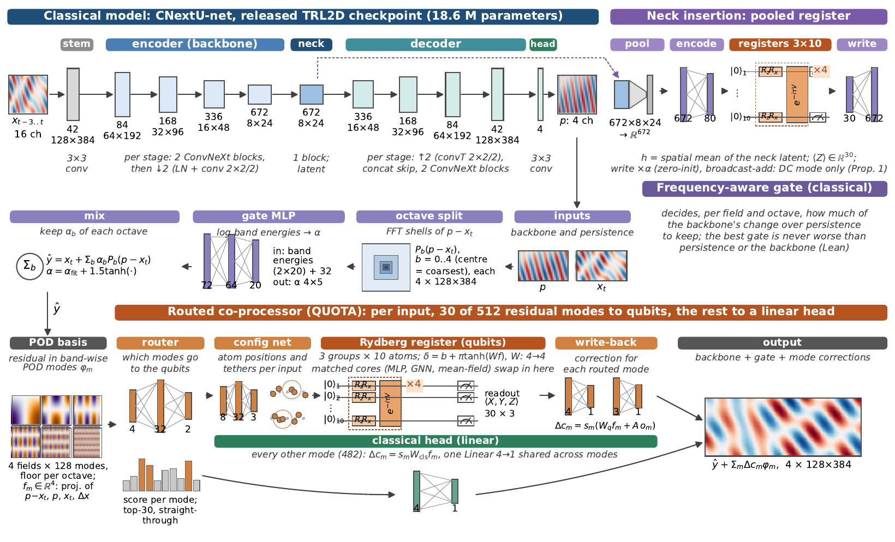
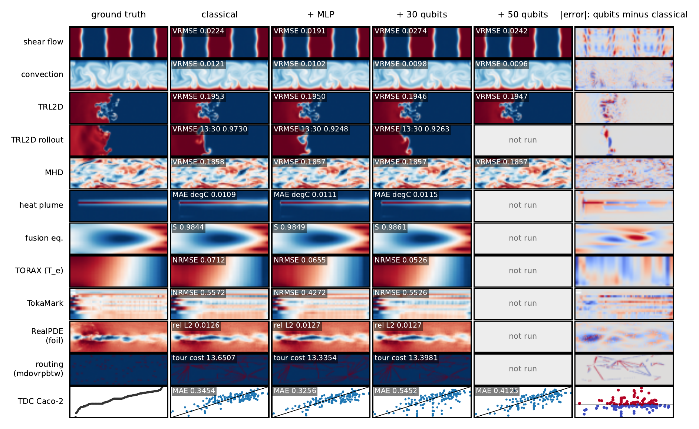
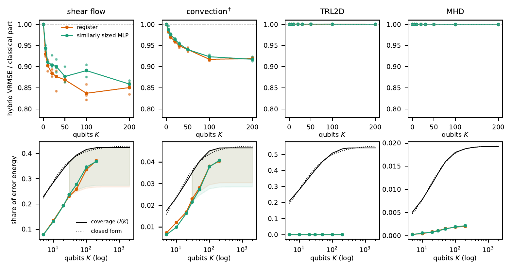
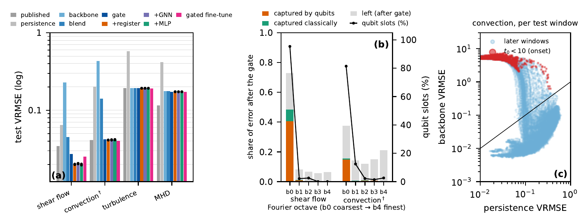
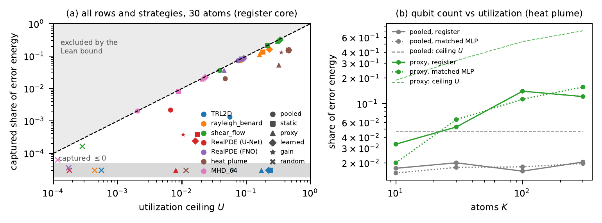
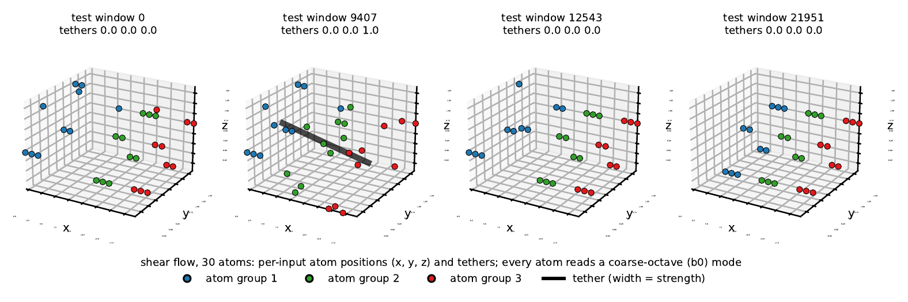
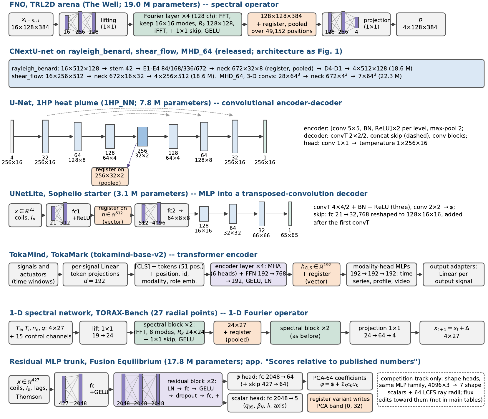
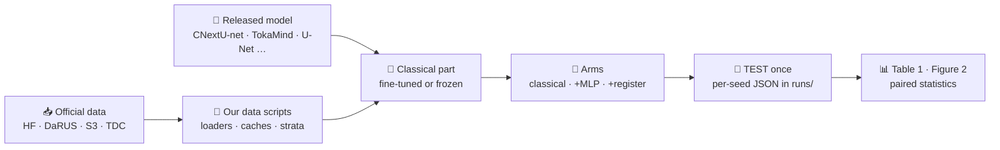

<div align="center">

# Utilization over Qubits
### Rydberg Registers in Physics World Models

**QUOTA** · *Qubit Utilization thrOugh Trained Allocation*

[](paper/manuscript/iclr2027/main_iclr.pdf)
[](pyproject.toml)
[](pyproject.toml)
[](https://docs.astral.sh/uv/)
[](formal/)
[](#-benchmarks)



<sub><b>Figure 1.</b> Top: the released CNextU-net and the standard <i>pooled</i> register in its neck.
Middle: the frequency-aware gate. Bottom: the <b>routed co-processor</b>. Per input, 30 of 512 residual modes go to a
30-atom Rydberg register and the rest go to a linear head. Matched classical cores swap into the register's slot.</sub>

</div>

---

## ✨ At a glance

| | |
|:--|:--|
| 🎯 **Same 30 qubits, routed vs pooled** | error **−36 %** with routing vs **−7 %** with the standard pooled design (convection) |
| 📈 **Qubit budget 0 → 100 → 200** | error falls **16 %** (shear flow) and **8 %** (convection) up to 100 qubits, then levels off |
| ⚖️ **Register vs matched classical core** | a similarly sized classical core behind the same routing gains as much; no consistent quantum edge at simulable sizes |
| 🧮 **Machine-checked (Lean 4)** | a pooled register reads and writes only the DC mode; the optimal band gate is never worse than persistence or the backbone |
| 🖥️ **Compute** | everything ran on a single NVIDIA DGX Spark (GB10, 128 GB unified memory) with an exact statevector simulator |

---

## 🔭 What the models predict



<sub><b>Figure 2.</b> One test sample per benchmark, fixed in advance. Columns: ground truth · classical · + matched MLP ·
+ 30 qubits · + 50 qubits · change in absolute error from classical to the largest register shown (blue: lower).
Each panel shows that sample's error (<i>S</i> for fusion: higher is better).</sub>

---

## 📊 Results

<table>
<tr>
<td width="50%"><b>Error vs qubit budget</b><br></td>
<td width="50%"><b>Where the error lives: the frequency gate</b><br></td>
</tr>
<tr>
<td width="50%"><b>Allocation strategies vs the Lean utilization bound</b><br></td>
<td width="50%"><b>Per-input atom positions and tethers (shear flow, 30 atoms)</b><br></td>
</tr>
</table>

<details>
<summary><b>🏗️ Every backbone and its insertion point</b> (FNO, CNextU-net, U-Net, UNetLite, TokaMind, 1-D spectral, residual MLP)</summary>
<br>

</details>

The full tables (Table 1, the matched-control audit, per-seed results) are in the paper:
[`paper/manuscript/iclr2027/main_iclr.pdf`](paper/manuscript/iclr2027/main_iclr.pdf).

---

## 🧪 Benchmarks

| | Benchmark | Data | Classical part | Register | Entry point |
|:-:|:--|:--|:--|:--|:--|
| 🌊 | Shear flow | The Well `shear_flow` | CNextU-net (released) | routed + neck | [`paper/alloc/adrc.py`](paper/alloc/adrc.py) |
| 🔥 | Convection (Rayleigh–Bénard) | The Well `rayleigh_benard` | CNextU-net (released) | routed + neck | [`paper/alloc/adrc.py`](paper/alloc/adrc.py) |
| 🌀 | Turbulent radiative layer (TRL2D) + rollout | The Well `turbulent_radiative_layer_2D` | CNextU-net (released) | routed + neck | [`paper/phase_b/`](paper/phase_b/) |
| 🧲 | MHD | The Well `MHD_64` | CNextU-net 3-D (released) | routed + neck | [`paper/phase_b/finetune_mhd.py`](paper/phase_b/finetune_mhd.py) |
| 🧪 | FNO arena | TRL2D | FNO | neck | [`paper/train.py`](paper/train.py) |
| ☢️ | Tokamak transport | TORAX-Bench (generated) | 1-D spectral network | neck | [`paper/torax_bench/`](paper/torax_bench/) |
| ♨️ | Geothermal heat plume | Pelzer 1HP (DaRUS) | 1HP_NN U-Net | neck | [`paper/geothermal/`](paper/geothermal/) |
| ⚛️ | Fusion equilibrium | Sophelio DIII-D | starter UNetLite | vector latent | [`paper/sophelio/`](paper/sophelio/) |
| 📡 | Tokamak signals | TokaMark (FAIR-MAST) | TokaMind | CLS latent | [`paper/tokamark/tokamind_hybrid.py`](paper/tokamark/tokamind_hybrid.py) |
| ✈️ | Real flow, airfoil | RealPDEBench | released U-Net | low-mode corrector | [`paper/realpde/arms.py`](paper/realpde/arms.py) |
| 🚚 | Vehicle routing | RouteFinder · RRNCO | RF-Transformer · RRNet | routed node register | [`paper/vrp/`](paper/vrp/) |
| 💊 | Molecules, Caco-2 | TDC ADMET | frozen embedding + head | bottleneck | [`paper/tdc/run_admet.py`](paper/tdc/run_admet.py) |

**Arms**, identical outside the core:

| Neck / latent insertion (`<variant>`) | Routed co-processor (`--arm`) |
|:--|:--|
| `vanilla` classical · `mlp30` matched MLP · `mr30ryd` 3 × 10-atom Rydberg register · `gutz30` mean-field control · `mr30hea` hardware-efficient ansatz | `cls_only` linear head · `adrc_mlp` · `adrc_ryd` register · `adrc_gnn` · `adrc_gutz` · `--atoms 50 / 100 / 200` |

---

## ⚡ Quick start

```bash
git clone https://github.com/MuhammadHakami/QuWorld.git && cd QuWorld
uv sync                               # Python 3.12+, PyTorch (CUDA 13), the_well, neuraloperator
bash reproduce/trl2d.sh data          # TRL2D (7.9 GB) + the released CNextU-net checkpoint
bash reproduce/trl2d.sh anchor        # the released checkpoint's one-step TEST VRMSE (873 windows)
```

---

## 🔁 Reproducing the results



**Protocol:** TRAIN fits → VALID selects → TEST is scored once · three seeds per arm · every arm gets the same
Optuna trial budget · stratified VALID samples are fixed before any score (`paper/strat/*/`).

### 1 · One script per task

Each script follows the runner that produced the paper's numbers. Every step skips outputs that already exist, so a
model is never scored on TEST twice. Run every step with `bash reproduce/<task>.sh`, or one step with
`bash reproduce/<task>.sh <step>`.

| | Task | Table 1 rows | Script | Steps | Original runner |
|:-:|:--|:--|:--|:--|:--|
| 🌀 | TRL2D | top (routed) · bottom (rollout 13:30) | [`trl2d.sh`](reproduce/trl2d.sh) | `data` `anchor` `train` `routed` `rollout` | [`run_overnight_detached.sh`](paper/phase_b/run_overnight_detached.sh) · [`alloc_bgp_trl2d_runner.sh`](runs/alloc_bgp_trl2d_runner.sh) · [`td_replication_runner.sh`](runs/td_replication_runner.sh) |
| 🔥 | Convection | top (routed) · middle (pooled neck) | [`convection.sh`](reproduce/convection.sh) | `data` `anchor` `train` `routed` | [`well2d_runner.sh`](runs/well2d_runner.sh) · [`s32_runner.sh`](runs/s32_runner.sh) |
| 🌊 | Shear flow | top (routed) · middle (pooled neck) | [`shear_flow.sh`](reproduce/shear_flow.sh) | `data` `anchor` `train` `routed` | [`well2d_runner.sh`](runs/well2d_runner.sh) · [`alloc_gate2_caches.sh`](runs/alloc_gate2_caches.sh) |
| 🧲 | MHD | top (routed) · middle (pooled neck) | [`mhd.sh`](reproduce/mhd.sh) | `data` `anchor` `train` `routed` | [`run_mhd_campaign.sh`](paper/phase_b/run_mhd_campaign.sh) · [`alloc_bgp_mhd_runner.sh`](runs/alloc_bgp_mhd_runner.sh) |
| 🧪 | FNO arena | middle (pooled neck) | [`fno_arena.sh`](reproduce/fno_arena.sh) | `data` `train` | [`run_ag_wave15.sh`](paper/run_ag_wave15.sh) |
| ☢️ | Tokamak transport | middle (pooled neck) | [`torax.sh`](reproduce/torax.sh) | `data` `train` | [`hpo_none_ms_runner.sh`](runs/hpo_none_ms_runner.sh) · [`hpo_ms_runner.sh`](runs/hpo_ms_runner.sh) |
| ♨️ | Heat plume | middle (pooled neck) | [`heat_plume.sh`](reproduce/heat_plume.sh) | `data` `pretrain` `train` | [`pelzer_unet_runner.sh`](runs/pelzer_unet_runner.sh) · [`hpo_ms_runner.sh`](runs/hpo_ms_runner.sh) |
| ⚛️ | Fusion equilibrium | middle (pooled neck) · our best | [`fusion_equilibrium.sh`](reproduce/fusion_equilibrium.sh) | `data` `train` `best` | [`hpo_none_ms_runner.sh`](runs/hpo_none_ms_runner.sh) · [`hpo_ms_runner.sh`](runs/hpo_ms_runner.sh) |
| 📡 | Tokamak signals | middle (pooled neck) | [`tokamark.sh`](reproduce/tokamark.sh) | `env` `data` `train` `eval` | [`tokamind_runner.sh`](runs/tokamind_runner.sh) |
| ✈️ | Real flow, airfoil | bottom | [`realpde_foil.sh`](reproduce/realpde_foil.sh) | `data` `anchor` `train` | [`realpde_arms_runner.sh`](runs/realpde_arms_runner.sh) |
| 🚚 | Routing, RouteFinder | bottom | [`routing_routefinder.sh`](reproduce/routing_routefinder.sh) | `data` `strata` `train` | [`rf_eal_runner.sh`](runs/rf_eal_runner.sh) |
| 🚚 | Routing, RRNCO | bottom | [`routing_rrnco.sh`](reproduce/routing_rrnco.sh) | `data` `train` | [`s41b_runner.sh`](runs/s41b_runner.sh) |
| 💊 | Molecules, Caco-2 | bottom | [`tdc_caco2.sh`](reproduce/tdc_caco2.sh) | `train` | [`tdc_runner.sh`](runs/tdc_runner.sh) |
| 📊 | Paper | generated tables and figures | [`paper_tables.sh`](reproduce/paper_tables.sh) | | [`paper_refresh.sh`](runs/paper_refresh.sh) |

Shared helpers (the routed co-processor's cache and its five arms x three seeds) live in
[`reproduce/common.sh`](reproduce/common.sh).

### 2 · Datasets and our data scripts

| | Benchmark | Official data | Size | Released model we start from | Our data scripts |
|:-:|:--|:--|:--|:--|:--|
| 🌀 | TRL2D | [polymathic-ai/turbulent_radiative_layer_2D](https://huggingface.co/datasets/polymathic-ai/turbulent_radiative_layer_2D) | 7.9 GB | [UNetConvNext-TRL2D](https://huggingface.co/polymathic-ai/UNetConvNext-turbulent_radiative_layer_2D) | [`data_ram.py`](paper/phase_b/data_ram.py) · [`rollout_windows.py`](paper/phase_b/rollout_windows.py) · [`paper/data.py`](paper/data.py) (FNO arena) |
| 🔥 | Convection | [polymathic-ai/rayleigh_benard](https://huggingface.co/datasets/polymathic-ai/rayleigh_benard) | 370 GB | [UNetConvNext-rayleigh_benard](https://huggingface.co/polymathic-ai/UNetConvNext-rayleigh_benard) | [`well2d.py`](paper/phase_b/well2d.py) · [`strat/rb/make_strata.py`](paper/strat/rb/make_strata.py) |
| 🌊 | Shear flow | [polymathic-ai/shear_flow](https://huggingface.co/datasets/polymathic-ai/shear_flow) | 471 GB | [UNetConvNext-shear_flow](https://huggingface.co/polymathic-ai/UNetConvNext-shear_flow) | [`well2d.py`](paper/phase_b/well2d.py) |
| 🧲 | MHD | [polymathic-ai/MHD_64](https://huggingface.co/datasets/polymathic-ai/MHD_64) | 159 GB | [UNetConvNext-MHD_64](https://huggingface.co/polymathic-ai/UNetConvNext-MHD_64) | [`data_ram_mhd.py`](paper/phase_b/data_ram_mhd.py) · [`strat/mhd/make_strata.py`](paper/strat/mhd/make_strata.py) |
| ☢️ | Tokamak transport | generated with [TORAX](https://github.com/google-deepmind/torax) v1.4.3 | 44 MB | trained from scratch | [`generate_v1.py`](paper/torax_bench/generate_v1.py) · [`splits.json`](paper/torax_bench/splits.json) · [`CARD.md`](paper/torax_bench/CARD.md) · [`baselines.py`](paper/torax_bench/baselines.py) |
| ♨️ | Heat plume | DaRUS [darus-3653](https://doi.org/10.18419/darus-3653) (prepared) · [darus-3650](https://doi.org/10.18419/darus-3650) (raw) | small | [1HP_NN](https://github.com/JuliaPelzer/1HP_NN) U-Net, pretrained by us | [`geothermal/data.py`](paper/geothermal/data.py) · [`prepare_1000dp.py`](paper/geothermal/prepare_1000dp.py) |
| ⚛️ | Fusion equilibrium | [Sophelio/fusion-equilibrium-challenge](https://huggingface.co/datasets/Sophelio/fusion-equilibrium-challenge) | 104 GB | [starter UNetLite](https://github.com/Sophelio/fusion-equilibrium-challenge-starter) | [`sophelio/extract.py`](paper/sophelio/extract.py) · [`sophelio/sota.py`](paper/sophelio/sota.py) · [`strat/fusion/strata.py`](paper/strat/fusion/strata.py) |
| 📡 | Tokamak signals | FAIR-MAST `s3://mast/tokamark/v1` ([TokaMark](https://github.com/UKAEA-IBM-STFC-Fusion-FMs/tokamark)) | streamed | [tokamind-base-v2](https://huggingface.co/UKAEA-IBM-STFC/tokamind-base-v2) | [`tokamark/dataset.py`](paper/tokamark/dataset.py) · [`fetch_sample.py`](paper/tokamark/fetch_sample.py) · [`verify_stream.py`](paper/tokamark/verify_stream.py) · [`task_meta.py`](paper/tokamark/task_meta.py) · [`strat/tokamark/make_strata.py`](paper/strat/tokamark/make_strata.py) |
| ✈️ | Real flow, airfoil | [AI4Science-WestlakeU/RealPDEBench](https://huggingface.co/datasets/AI4Science-WestlakeU/RealPDEBench) (`foil/`) | foil subset | [RealPDEBench-models](https://huggingface.co/AI4Science-WestlakeU/RealPDEBench-models) (`foil/`) | [`realpde/common.py`](paper/realpde/common.py) · [`predict_split.py`](paper/realpde/predict_split.py) · [`error_bands.py`](paper/realpde/error_bands.py) |
| 🚚 | Vehicle routing | [ai4co/routefinder](https://huggingface.co/datasets/ai4co/routefinder) · [ai4co/rrnco](https://huggingface.co/datasets/ai4co/rrnco) | 0.4 · 2.2 GB | [RouteFinder](https://github.com/ai4co/routefinder) RF-Transformer · [RRNCO](https://github.com/ai4co/real-routing-nco) RRNet | [`vrp/rf_compat.py`](paper/vrp/rf_compat.py) · [`strat/routing/make_strata.py`](paper/strat/routing/make_strata.py) |
| 💊 | Molecules, Caco-2 | [TDC ADMET group](https://tdcommons.ai/benchmark/admet_group/overview/) `caco2_wang` | small | frozen ChemBERTa embedding | [`tdc/tdcdata.py`](paper/tdc/tdcdata.py) |

Shared by the Well rows: [`paper/alloc/adrc_cache.py`](paper/alloc/adrc_cache.py) caches the backbone's residual as band-wise
POD modes with the gate statistics. [`paper/alloc/cache.py`](paper/alloc/cache.py) builds the Haar-tile caches for the
allocation study (Well and RealPDE).

Each task script's `data` step downloads and prepares only that task's data.

### 3 · Environments and upstream code

| Environment | Used for | Key packages (versions we ran) |
|:--|:--|:--|
| `.venv` (`uv sync`) | Well rows, routed co-processor, fusion, heat plume, RealPDE, FNO arena, figures | torch (CUDA 13), the_well, neuraloperator |
| `.venv-well` | TFNO checkpoints | neuraloperator 0.3.0 |
| `.venv-tokamark` | TokaMark, TokaMind | tokamark 0.1.0, tokamind 0.1.0 (from their repos) |
| `.venv-vrp` | RouteFinder, RRNCO | rl4co 0.7.0, torchrl 0.14 |
| `.venv-tdc` | TDC Caco-2 | PyTDC 0.3.6, chemprop 2.3.1 |
| TORAX venv | TORAX-Bench generator | torax 1.4.3 (JAX, CPU, float64) |

Upstream code is used in place; clone it into `baseline/`, which is git-ignored:

| Folder | Repository |
|:--|:--|
| `baseline/the_well` | [PolymathicAI/the_well](https://github.com/PolymathicAI/the_well) |
| `baseline/1HP_NN` | [JuliaPelzer/1HP_NN](https://github.com/JuliaPelzer/1HP_NN) |
| `baseline/sophelio-starter` | [Sophelio/fusion-equilibrium-challenge-starter](https://github.com/Sophelio/fusion-equilibrium-challenge-starter) |
| `baseline/tokamark`, `tokamark_baseline`, `tokamind` | [UKAEA-IBM-STFC-Fusion-FMs](https://github.com/UKAEA-IBM-STFC-Fusion-FMs) |
| `baseline/RealPDEBench` | [AI4Science-WestlakeU/RealPDEBench](https://github.com/AI4Science-WestlakeU/RealPDEBench) |
| `baseline/routefinder`, `rrnco`, `rl4co` | [ai4co/routefinder](https://github.com/ai4co/routefinder) · [ai4co/real-routing-nco](https://github.com/ai4co/real-routing-nco) · [ai4co/rl4co](https://github.com/ai4co/rl4co) |
| `baseline/flowers` | [t-muser/flowers](https://github.com/t-muser/flowers) |
| `baseline/TDC`, `MapLight-TDC` | [mims-harvard/TDC](https://github.com/mims-harvard/TDC) · [maplightrx/MapLight-TDC](https://github.com/maplightrx/MapLight-TDC) |

### 4 · From result files to the paper

| Paper item | Script | Writes |
|:--|:--|:--|
| Figure 1 · backbone figure | [`fig_arch.py`](paper/alloc/fig_arch.py) · [`fig_arch_backbones.py`](paper/alloc/fig_arch_backbones.py) | `fig_arch.pdf` · `fig_arch_backbones.pdf` |
| Table 1, top block (routed) | [`table1_routed.py --latex`](paper/alloc/table1_routed.py) | `tab_routed_rows.tex` |
| Figure 2 | `dump_rows_*` / [`render_routed.py`](paper/alloc/render_routed.py) → [`fig_outputs_all.py`](paper/alloc/fig_outputs_all.py) | `paper/fig_cache/rows_s23/*.npz` → `fig_outputs_all.pdf` |
| Hybrid scaling | [`fig_hybrid_scaling.py`](paper/alloc/fig_hybrid_scaling.py) | `fig_hybrid_scaling.pdf` |
| Allocation study | [`analyze.py table`](paper/alloc/analyze.py) · [`figs.py`](paper/alloc/figs.py) · [`fill_paper.py`](paper/alloc/fill_paper.py) | `fig_alloc.pdf`, Table `tab:alloc` |
| Gate and fine-tuning appendix | [`adrc_summary.py`](paper/alloc/adrc_summary.py) · [`gate_table.py`](paper/alloc/gate_table.py) · [`fig_gate.py`](paper/alloc/fig_gate.py) | gate tables, `fig_gate.pdf` |
| Matched-control audit | [`fig_audit.py`](paper/alloc/fig_audit.py) · [`paired_stats.py`](paper/phase_b/paired_stats.py) | `fig_audit.pdf` |
| TRL2D four-seed replication | [`td_replication_summary.py`](paper/phase_b/td_replication_summary.py) | `td_repl_table.tex` |
| Routing qubit ladder | [`rf_ladder.py`](paper/vrp/rf_ladder.py) | `fig_rf_ladder.pdf`, `rf_table.tex` |
| Probabilistic variant | [`fgn_summary.py`](paper/alloc/fgn_summary.py) | `fgn_table.tex` |

All outputs go to `paper/manuscript/iclr2027/`; [`reproduce/paper_tables.sh`](reproduce/paper_tables.sh) runs them in
order and builds the PDF. Results land in `runs/` as one JSON or CSV per arm and seed. Most per-seed result files
behind the paper's tables are already in `runs/`; checkpoints and per-window prediction dumps are not.

---

## 🧮 Lean proofs

```bash
cd formal && lake update && lake build && lake env lean Audit.lean     # Lean 4.19 + mathlib, no sorry
```

| File | Statement |
|:--|:--|
| [`SpectralRouting.lean`](formal/QuotaScaling/SpectralRouting.lean) | `pool_blind`: a pooled insertion reads and writes only the DC mode of its latent |
| [`BandGate.lean`](formal/QuotaScaling/BandGate.lean) | `gate_opt_le_persistence`, `gate_opt_le_trunk`: the optimal band gate is never worse than persistence or the backbone |
| [`Routing.lean`](formal/QuotaScaling/Routing.lean) | `token_energy_bound`: routed corrections are bounded per token |
| [`Utilization.lean`](formal/QuotaScaling/Utilization.lean) | `gain_le_ceiling`: captured error energy ≤ the utilization ceiling *U* |

---

## 🗺️ Repository map

```text
paper/
├── alloc/          routed co-processor, gate, caches, Table 1 + figures   (adrc*.py, fig_*.py)
├── phase_b/        CNextU-net fine-tuning and evaluation on The Well      (finetune*.py, eval_*.py)
├── qlayer.py       exact Rydberg statevector layer (autograd)             model.py: cores and bottlenecks
├── sophelio/ tokamark/ torax_bench/ geothermal/ realpde/ vrp/ tdc/        one folder per benchmark
├── hpo/            Optuna driver: same trial budget for every arm
└── manuscript/iclr2027/   paper source + PDF
reproduce/          one reproduction script per task (data -> train -> TEST once) + paper_tables.sh
formal/             Lean 4 statements (QuotaScaling/*.lean)
runs/               logs, per-seed result JSONs and runner scripts behind the paper's numbers
docs/figures/       the figures shown on this page
NN-*.md             the timestamped research record (protocols registered before each run)
```

Large files (checkpoints, datasets, prediction dumps) are not in git. Download the data as shown above, or regenerate
them with the commands in each section.

## 📄 Build the paper

```bash
cd paper/manuscript/iclr2027 && tectonic main_iclr.tex       # -> main_iclr.pdf
```
